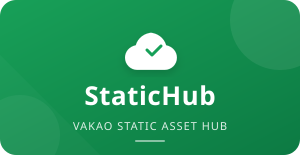

# Vakao Static Hub

  

基于 **Go 1.27** + **Vue 3** 的静态资源管理系统，采用 pnpm monorepo（`packages/shared` / `packages/server` / `packages/client`）。提供多根目录文件管理、随机图片服务、占位图生成、一言代理、文件分享链接和 APP 在线更新中心等能力。

## 文档索引

| 文档 | 内容 |
| --- | --- |
| [核心特性](./docs/features.md) | 这个项目能做什么 |
| [本地开发](./docs/development.md) | 技术栈、快速开始、根目录命令、目录结构、本地构建 |
| [部署](./docs/deployment.md) | 打包、服务器启动与重启、升级、Nginx 反向代理（`/v1` 绕过 proxy_cache） |
| [配置说明](./docs/configuration.md) | 全部环境变量与默认值 |
| [resource-roots.json](./docs/resource-roots.md) | 根目录播种文件的行为与取舍 |
| [缓存机制](./docs/cache.md) | 缩略图缓存、Office 转换缓存、分享文件缓存与 CDN 刷新 |
| [API 概览](./docs/api.md) | 响应信封、鉴权约定、路由分组 |
| [数据库](./docs/database.md) | SQLite 与迁移说明 |
| [前端文档](./packages/client/README.md) | 客户端独立说明 |
